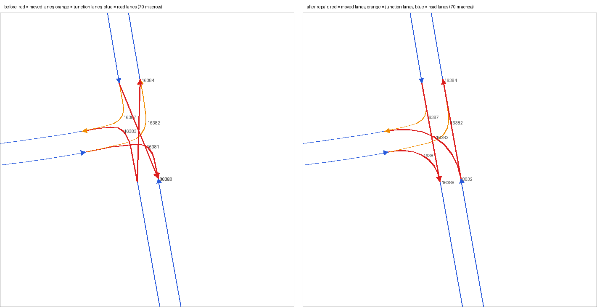

# Better Car AI (Cyberpunk 2077 v2.5)

- **BCAI Autodrive+** (needs the native plugin): the mod's own driving AI, in three driving styles you pick when it starts: **City** (by the rules), **Aggressive** (fast and hard) and **Madman** (as fast as it can without crashing). See below.
- **Better routes to the map destination** (needs the native plugin): the mod plans its own route to your map pin or tracked quest, for time rather than distance (highways, fewer junctions, fewer left turns across traffic, no needless U-turns), and ends it on the pin's level: a pin under a highway or next to a bridge gets a route to the street, not onto the road above it. It draws the route on the road ahead with the next turn at the top of the screen, and plans again when you leave it. Autodrive+ drives the same planner's route. See *Navigation* below.
- **Calm traffic:** a light tap no longer makes NPC drivers flee, bail out, get knocked out or start a fight, and people on the pavement no longer run from a fender-bender next to them. A tapped driver honks (with a voice line) and keeps driving; tapped again soon after, it honks and flashes its lights; keep tapping the same car (4 taps within 30 s by default) and the driver loses patience and reacts the game's way (drives off in a panic, or gets out). Hard crashes, gunfire, drawn weapons, combat and the police still get the vanilla reactions.
- **Calmer panic driving:** NPCs fleeing a crash or gunfire drive a little slower and look further ahead for bends, so they wreck less.
- **Smoother autodrive:** a longer look-ahead and slightly more confident cornering mean less stop-start jerkiness.
- **Aggressive tuning for the game's autodrive** (in *Older drivers & tuning*, or a hotkey): raises autodrive's speed cap, asks traffic ahead to clear the way, looks about 3× further ahead for obstacles, ignores speed limits, swerves around traffic faster and gets more power and grip. It is built on the car's normal autodrive tuning. Basing it on the race-AI params is an experimental option, because they made the car rev and brake constantly in testing.
- **AI drive** (the default for autodrive): native autodrive holds about 86 km/h no matter what, so when you start autodrive the mod turns it off and drives the car with the AI command police and quest drivers use. That command honours the aggressive max speed and traffic clearing. It drives to the autodrive destination, or straight down the road if none is set, and brakes to a stop on arrival. Steer, accelerate or brake to take back control. Turn off *The game's autodrive starts AI drive* (in *Older drivers & tuning*) to get vanilla autodrive back; Delamain cab rides are never taken over. It also has its own hotkey.
- **Stability governor** (AI drive): slows the car while it slides sideways, weaves after an overcorrection, is airborne, or is about to crest a rise fast enough to take off, and keeps a 2 s gap behind a car straight ahead so a dodge happens at a survivable speed. It also learns **trouble spots**: places where AI drive snapped the wheel or took a bend far too fast with no car around (usually a kink in the game's lane path at a junction). It saves them to `trouble_spots.json` and slows to a set speed (default 60 km/h) before them next time. The *Older drivers & tuning* window's *AI drive* tab shows how many it has learned and has a button to forget them all.
- **NPC traffic tuning:** AI-driven NPC cars get more confident cornering and a longer look-ahead.

## Requirements
- Cyber Engine Tweaks
- redscript (+ RED4ext)
- TweakXL is **not** required. TweakDB changes are applied at runtime through CET.

## Install
```bash
./install.sh                     # default game path
./install.sh "/path/to/Cyberpunk 2077"
./install.sh --uninstall
```
Or copy `r6/` and `bin/` into the game folder.

## Use
Open the CET overlay. The **Better Car AI** window has:
- **Autodrive+:** whether it is driving (speed, what it is doing, the style) and a *Start/Stop* button.
- **Driving style:** City, Aggressive or Madman, with what each does. Each style keeps its own settings (top speed, speed vs the speed limit, cornering grip, braking, following distance) under *<style> settings*; they apply at once, even while it drives.
- *Ask which style each time it starts* (on by default) and *The game's autodrive button starts Autodrive+*.
- **Navigation:** your own route to the map destination: on or off, drawn on the road, the next turn, and the route it has now.
- **NPC traffic:** calm traffic (and the impact speed that still counts as a crash), honking, people nearby staying calm, how many taps before a driver loses patience, faster traffic, calmer panic driving.
- **Overlay:** show it, how much its panel shows, and which layers it draws.
- *Older drivers & tuning* opens a window for the game's own autodrive (normal/aggressive tuning), NPC traffic tuning, AI drive and motorcycles. *Debug tools* opens the lane map, recorder, vehicle, lanes & routes, Autodrive+ internals and research tools.

Most changes apply when the overlay closes (or with *Apply now*); the style settings apply at once. Everything is saved to `settings.json`.

**Style picker:** when Autodrive+ starts (button, hotkey or the game's autodrive button), a picker shows the three styles for 6 s. Steer left/right to choose, accelerate to start (it starts once you let go), brake or press the autodrive button again to cancel; when the time runs out it starts with the highlighted style. With the CET overlay open you can click a style instead. Turn the picker off to start straight away with the chosen style.

**Hotkeys** (CET > Bindings > Better Car AI): *Autodrive+: start / stop*, *next driving style*, one for each style (they also switch styles while it drives), *Overlay: show / hide*, *Overlay: compact / normal / everything*, the lane map, saving a recording, and the older drivers' toggles.

**Visual debug overlay:** bind *Overlay: show / hide* (or tick it in the main window). It draws, over the game (each layer can be switched off):
- Autodrive+'s planned line, coloured by the speed it plans there against the speed now (blue: as fast; yellow, orange, red: slowing), with the slowest point ahead labelled; the road's edges (grey); what its sensor sees (orange cars, red walls) and what is in its way (magenta, labelled with its distance and speed). Without Autodrive+, the game's route in blue (with the plugin);
- the destination (a tall magenta pillar, with a line to it);
- the line the car actually drove: green while gripping, yellow or red while sliding sideways, magenta while airborne;
- where its current speed and turn rate carry it in the next 2 s (cyan), plus its heading (white) and actual travel direction (cyan);
- a fan of look-ahead rays: orange stops at a car, red at a wall or railing, yellow at road rising ahead, grey is clear.

Its panel (compact, normal or everything) shows the speed, and while Autodrive+ drives: its target and the road's speed, what it is doing (cruising, following, overtaking, going round, dropping back, waiting at a junction...) and what is holding its speed down, what is ahead, which lane it is in and heading for (counted from the right), the next slow-down, the distance to the destination, its throttle, brake and steering, and its latest decisions (three, or six with *everything*) with how long ago each was. It also shows what is under the car: road, dirt, grass (with the game's name for the surface), or *airborne* only when the game says the car is in the air. *Everything* adds the drive's statistics (metres off the road, replans, lane changes, changes of mind), the learned grip and a colour legend. The world measurements refresh 30 times a second, the panel every frame.

**Drive recorder:** while you're in a vehicle, the mod keeps the last 60 s of driving (10 samples a second): position, heading, velocity, speed, sideways slip, turn rate, ground contact, the look-ahead rays, the AI command's speed caps, the stability governor, RPM, gear, suspension forces and collisions. When AI drive spins out, crashes above 36 km/h or stops dead (hard braking and your own driving after you take over don't count), it saves the recording 5 s later as `rec_<date>_<time>.csv` in the CET mod folder. Bind *Save drive recording* (or use the button in the debug window's *Recorder* tab) to save one by hand. `tools/analyze_recording.py rec_....csv --png out.png` explains in plain words what happened around the wipe-out, lists every steering snap (the driver yanking the wheel at speed) with what was ahead, prints a second-by-second table, and with `--png` draws a map of the incident plus speed, turn-rate-vs-grip and slip-angle graphs with snaps marked (needs Pillow). The AI's actual steering input isn't readable from scripts, so steering is estimated from the turn rate.

**BCAI Autodrive+ (experimental, needs the native plugin):** the mod's own driving AI, replacing the game's. It plans its route over the city's lane map, to the map destination or along the road without one. It works the car's throttle, brake and wheel itself, so the car still drives on the game's real physics.
- **Flowing line:** it doesn't trace the lanes exactly. It smooths them the way a driver would: rounding sharp junction corners and drifting across lanes gently, but held towards its lane and kept away from the road's edges. Off junctions it stays on its own side of the road.
- **Sensing:** rays find cars and walls on the road ahead, in the lanes beside and behind it (for changing lanes), right beside it (the blind spot), and along the roads across the next junction. Rays tilt with the car on slopes and stay above the road over crests. It groups a car's hits into one outline, remembers the whole outline of a parked car, and measures how fast each car moves along the road and across it.
- **Vehicles from the game:** it also asks the game which vehicles are nearby (where each is, how it moves, whether it is parked), so it knows a car's speed the moment it sees it. The rays then only fill in each car's size, and still find everything the game doesn't list.
- **Routes:** the navigator's (see *Navigation*): the quickest way, ending on the pin's level, at a lane it can reach.
- **Fits the car:** it measures the car's length and width when it starts, and learns its grip, braking, acceleration and turning as it drives, so a wide, heavy car and a tiny slow one are each driven within what they can do.
- **Getting round things:** it plans each sideways move by driving it ahead in time against where every car will be, at its current speed, speeding up and slowing down. It overtakes slower cars in another lane going its way when there is room behind and beside, and checks behind before moving over (no cutting in front of a faster car). It uses the oncoming lane to get past something parked, or a car stopped in its lane for a while (City 20 s, Aggressive 5 s, Madman 1.5 s; not one queueing behind another car or just before a junction), only when nothing coming the other way would get there first, giving up and dropping back if something does.
- **Driving styles:** *City* keeps to about 1.3× the roads' traffic speed (top 110 km/h), keeps right on any road with more than one lane going its way, overtakes only what stands still (or a car crawling at under a third of its speed), and leaves a 2 s gap. *Aggressive* (the old defaults: 2.2× traffic speed, top 180 km/h) keeps right on roads with three lanes or more, and also overtakes slow cars on the other side of the road when it can see that nothing is coming for as far as the pass takes and no roads cross on the way. *Madman* (3× traffic speed, top 250 km/h, 0.8 s gap) keeps whatever lane is clearest, overtakes whenever nothing is coming, takes junctions faster and only slows for cars it sees crossing. In every style it waits a moment after a lane change before the next, and moves into a lane only once that lane has looked clear for a moment, so it doesn't flip back and forth. It passes parked cars at no more than about 30 km/h, and doesn't swing out round moving traffic in junctions. It gives way to cars crossing, and approaches a junction with cars waiting across it at a speed it can stop from. Boxed in behind something with a gap beside it, it backs up a little to get round; in a jam it waits. In an emergency it swerves harder, even into the oncoming lane.
- **Learning the car:** the game puts curves on the controls (a little steering barely turns the car, a little brake already brakes hard), so Autodrive+ learns how the car you're in answers the wheel and pedals while it drives. Its first minute in a new car can be a little less smooth.

Start it from the main window or with the *Autodrive+: start / stop* hotkey; steering or the pedals take over.

It doesn't stop at traffic lights or watch for pedestrians yet, in any style.

The debug window's *Vehicle* tab shows the live autodrive params for the car you're in, next to the vanilla autodrive, generic and race params. *Write to log* copies them into `BetterCarAI.log`.

## Navigation
The game's GPS goes for the shortest way, and where roads are stacked it can pick the wrong one: a pin under a highway (or a bridge, or a raised road) can get a route up onto it. (Which road the game picks for a pin, and why, isn't confirmed yet: the log's `Route |` lines record where the pin is and where the game put it.) With the native plugin (0.28+) the mod plans its own route over the game's lane map:
- **For time, not distance:** each road at the pace it is driven (highways faster, junction lanes slower), a few seconds for each junction, more for turning left across traffic, a lot for a U-turn.
- **Ending at the right place:** it looks at every road within 120 m of the pin and weighs how far each is from the pin, whether it is on the pin's level (a road more than a couple of metres above the pin, or more than 4 m below it, is another level) and how long it takes to get there. Highways count against stopping, unless the pin is on one. A pin without a real height (far above or below every road) counts as on the lowest road right by it, where the street is.
- **On screen:** a yellow line on the road ahead (300 m), and at the top of the screen the next turn (*Turn left in 240 m*, *Keep right*, *Make a U-turn*) with the distance and time left. Leave the route by more than 25 m for a moment and it plans a new one. Both can be switched off in the main window.
- **Autodrive+** plans with the same navigator, so it drives the route you see.

On 1,500 random trips across the dumped city, against the planner of 0.27 (shortest distance to the lane nearest the pin): the simulator's car got there 8-12% sooner, through 15% fewer junctions and a third fewer left turns, and where roads are stacked over the destination none of its routes ended on the wrong level (the old one: about 1 in 5).

The minimap and the world map still draw the game's own route: the GPS is native code. The debug window's *Research* tab has a scan that looks for where the GPS keeps it (set a map pin first), the first step to drawing our route there too.

## How it works / limits
See [docs/RESEARCH.md](docs/RESEARCH.md). In short, NPC reactions are script logic and are fixed directly. Autodrive steering is native code, so the mod tunes the TweakDB driving parameters it reads. It cannot add new behaviours such as forcing green lights.

## The log
The CET log is at `bin/x64/plugins/cyber_engine_tweaks/mods/BetterCarAI/BetterCarAI.log`. What goes in it is set in the debug window's *Recorder & log* tab:
- `Autodrive+ | ...`: every decision Autodrive+ makes, with seconds into the drive, speed, metres along the route and why: lane changes and swerves (from which lane to which, why, what was in the way, how the move scored), passing (begun, waiting for oncoming traffic, done, given up), what slows it down (following, stopping behind, a junction, going round, losing grip), hard braking, leaving the mapped road, backing up, replanning, the style and settings, and how the drive ended.
- `Autodrive+ raw: ...`: twice a second, the raw numbers (speeds, what is ahead, the line, steering, pedals, what it has learned about the car).
- `Traffic | ...`: what NPC drivers did about a bump (honk, honk and flash, lost patience), crashes, and when people near a lightly dented car stayed calm.
- `Route | ...`: each route planned to the map destination and why (a new destination, off the route, got in a car): its length, time, junctions and turns, how far from the pin it ends and on which level, and for a new destination where the pin is and where the game's autodrive put it.

`tools/drive_log.py BetterCarAI.log` sums each drive up (style, route, how it ended, its decisions counted by reason); `--events` lists every decision, `--traffic` every NPC reaction, `--routes` every route.

Lines starting with `flat not found` mean that a parameter name differs in your game version.

## Native plugin (RED4ext, optional, in progress)

`red4ext/` is a RED4ext plugin that gives the mod deeper access to the game's native vehicle AI. The mod works without it. The plugin ships its own script declarations (`BetterCarAINative.reds`), which are compiled in only while it's loaded.

It adds debugging tools to the debug window: the dumps are in the *Lanes & routes* and *Research* tabs, the lane map in *Overlay*.
- **Dump vehicle AI types:** lists the engine's types for vehicles, traffic, autopilot, driving, steering and lanes, with their fields and functions.
- **Dump car, AI component and drive command:** writes the live state of each of those objects, including fields scripts can't see.
- **Lane map: lanes within 60 m of the car:** reads the game's traffic lane table (every lane in the city) and lists the nearby lanes: their outline, kind (road, junction, sidewalk, no-autodrive...), speed limit and which lanes they lead into.
- **Lane map overlay** (*Overlay* tab, or the *Toggle lane map* hotkey): with the visual overlay on, draws every lane within 70 m with an arrow for its driving direction. Colours: pale blue road lanes, amber junction lanes, purple GPS-only lanes, red no-autodrive lanes, green lanes the plugin repaired, grey sidewalks (optional). Lanes near the car are numbered, and a red *dead end* marks driving lanes that lead nowhere.
- **Dump all lanes in the city:** writes the whole traffic lane map to `dumps/lanegraph.txt`, for finding broken junctions offline.
- **Dump the AI's route** (also a hotkey): writes the route the car is following (every lane from start to destination) to a file. With the plugin loaded, the visual debug overlay also draws the next 150 m of that route in blue.
- **Scan for the AI's planned path:** has a hotkey too. Run it while AI drive is running. It follows pointers from the car, its AI component, the drive command and the autodrive/traffic systems. It looks for arrays of points along the road ahead and for chains of linked lanes. The goal is to find where the native driver keeps its route.

With the plugin loaded, the mod also **repairs broken junctions** in the game's lane map (on by default, under AI drive). At 11 junctions, all on roads where the game has normal traffic turned off, the turn lanes are attached to the wrong side of the road. Any route through them makes the car swerve one lane sideways and back at the junction mouth, which is what spun AI drive at a T-junction. Those lanes are also missing their links to the road, so the route planner treats the road as a dead end there and routes around it. The plugin reconnects the lanes to the correct side, redraws them as smooth curves, and adds the missing links when the game loads. Only those junction lanes are changed, nothing is saved to disk, and switching the setting off undoes it.



AI drive also gets a **route speed planner** (AI drive section, on by default). It reads the route the AI is about to drive from the game's lane map, finds the bends and junction jogs in the next 400 m, and slows down early enough to take each one at the set grip (default 0.8 g). It needs the stability governor on. Unlike trouble spots, it works at junctions the car has never driven.

Output goes to `red4ext/plugins/BetterCarAI/dumps/`.

Build on Linux by cross-compiling with clang-cl and the MSVC runtime/Windows SDK from [xwin](https://github.com/Jake-Shadle/xwin):
```
git submodule update --init
xwin --accept-license splat --output ~/.local/share/xwin/sdk   # accepts Microsoft's license for the SDK files
./red4ext/build.sh        # needs clang-cl, lld-link, cmake, ninja (e.g. in a toolbox)
./install.sh              # also installs the plugin if red4ext/build/BetterCarAI.dll exists
```
